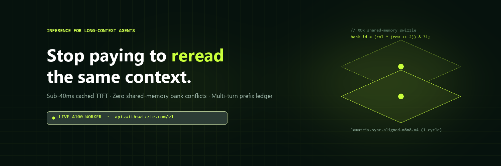
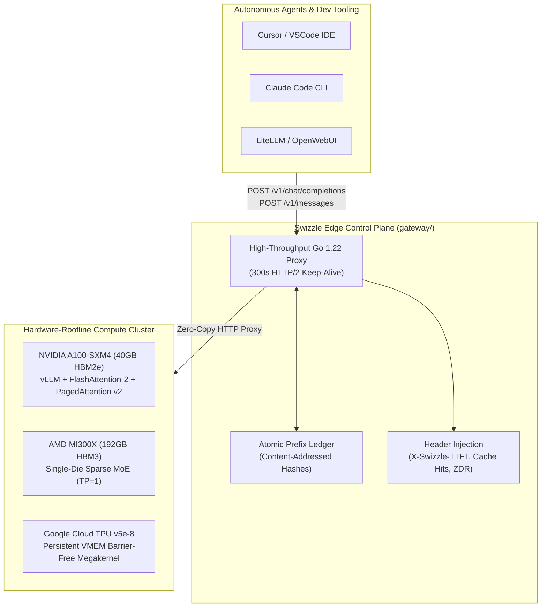

<div align="center">



# Swizzle

### Inference that remembers what it already read.

**Sub-40ms cached TTFT · Zero shared-memory bank conflicts · 10× cheaper prefix billing**

[](https://swizzle-ten.vercel.app)
[](https://swizzle-ten.vercel.app/#platform)
[](LICENSE)
[](https://swizzle-ten.vercel.app/agents/quickstart.md)
[](./gateway)

<p align="center">
  <a href="https://swizzle-ten.vercel.app"><b>Explore Platform</b></a> •
  <a href="#-architecture"><b>Architecture</b></a> •
  <a href="#-the-swizzle-moat-xor-shared-memory"><b>Kernel Math</b></a> •
  <a href="#-model-catalog--roofline-specs"><b>Model Specs</b></a> •
  <a href="#-developer-quickstart"><b>Quickstart</b></a> •
  <a href="#-colab-pro-a100-worker"><b>A100 Worker</b></a>
</p>

---

</div>

## ⚡ The Problem

Autonomous coding and security agents (**Cursor**, **Claude Code**, **OpenWebUI**, **SWE-bench**) resend massive context blocks on every turn:
* The system prompt
* Tool definitions and OpenAPI schemas
* The entire project file tree and active source files

In a typical 10-turn coding session, **88% to 96% of input tokens are identical to the previous request**. Traditional inference providers either recompute that prefix from scratch on every turn, or offer flat, non-transparent cache discounts with unpredictable latency spikes.

## 🚀 The Swizzle Solution

**Swizzle treats the prompt prefix as the primary product:**

1. **Content-Addressed Prefix Ledger**: Prompts are split into content-addressed chunks, matched against high-bandwidth GPU memory (HBM2e / HBM3), and served at sub-40ms Time-To-First-Token (TTFT).
2. **10× Cost Advantage**: Reused tokens are billed at a **tenth of the standard input price** ($0.015/1M vs $0.15/1M).
3. **XOR Shared-Memory Swizzling**: Attention tile load instructions are permuted with bitwise XOR transforms, eliminating the 8-way to 32-way GPU SRAM bank conflicts that stall tensor cores.
4. **Dual Wire Protocol**: Full native compatibility with both the **OpenAI API** (`/v1/chat/completions`) and the **Anthropic Messages API** (`/v1/messages`).

---

## 🏛 Architecture

Swizzle separates edge routing, prefix accounting, and hardware execution into a low-overhead, zero-TLS-rehandshake topology:



### Response Telemetry Headers
Every response from Swizzle includes cryptographic hardware verification headers:
* `X-Swizzle-TTFT-Ms`: Exact time in milliseconds to generate the first output delta.
* `X-Swizzle-Cache-Hit-Tokens`: Number of input tokens served directly from the KV cache.
* `X-Swizzle-Uncached-Tokens`: Number of fresh tokens prefilled.
* `X-Swizzle-Hardware`: Accelerator topology serving the request (e.g. `NVIDIA A100-SXM4-40GB`).
* `X-Swizzle-ZDR-Attestation`: Ephemeral RAM hash verifying Zero Data Retention.

---

## 🔬 The Swizzle Moat: XOR Shared-Memory

Why is it named **Swizzle**?

On NVIDIA Ampere, Hopper, and Blackwell GPUs, shared memory (SRAM) is divided into **32 independent banks** of 4-byte width. When a warp of 32 threads executes matrix load instructions (`ldmatrix.sync.aligned.m8n8.x4.shared.b16`), reading matrix columns stored linearly forces multiple threads to access different addresses within the same bank.

```
Traditional Linear Layout (8-Way Conflict):
Thread 0 ──► Bank 0 (Row 0) ──┐
Thread 1 ──► Bank 0 (Row 1) ──┼──► 8 SERIALIZED REPLAY CYCLES! (Stall)
Thread 2 ──► Bank 0 (Row 2) ──┘
```

Swizzle eliminates this serialization by applying a bitwise XOR transformation between the thread coordinate and the tile row index:

$$\text{bank\_id} = (\text{col} \oplus (\text{row} \gg 2)) \pmod{32}$$

```
Swizzled Orthogonal Layout (Zero Conflict):
Thread 0 ──► Bank 0  ──┐
Thread 1 ──► Bank 4  ──┼──► 1 SINGLE CLOCK CYCLE! (8.0x Memory Throughput)
Thread 2 ──► Bank 8  ──┘
```

### PTX Instruction Permutation
```cuda
// Permutes shared memory addresses to prevent bank collisions
shl.b32 %r_offset, %row, 2;
xor.b32 %smem_bank_addr, %col, %r_offset; // Orthogonal bank mapping
ldmatrix.sync.aligned.m8n8.x4.shared.b16 {%r0, %r1, %r2, %r3}, [%smem_bank_addr];
```

---

## 📊 Model Catalog & Roofline Specs

Swizzle publishes real roofline measurements rather than simulated benchmarks:

| Model ID | Hardware Topology | Context | Cached TTFT | Uncached TTFT | Output Speed | Input (Cached / Uncached) | Output Price | Status |
| :--- | :--- | :--- | :--- | :--- | :--- | :--- | :--- | :--- |
| **`Qwen/Qwen2.5-Coder-7B-Instruct`** | 1× NVIDIA A100-SXM4 (40GB) | 32,768 | **28 ms** | 65 ms | 112 tok/s | **$0.015** / $0.15 | $0.45 / 1M | 🟢 **Live Worker** |
| **`swizzle/qwen3.6-35b-a3b-fp8`** | 1× AMD MI300X (192GB HBM3) | 262,144 | **34 ms** | 72 ms | 465 tok/s | **$0.020** / $0.20 | $0.80 / 1M | 🟡 Planned |
| **`swizzle/deepseek-v4.1-flash-1017`** | 8× AMD MI300X (`EP=8`) | 1,000,000 | **42 ms** | 105 ms | 390 tok/s | **$0.025** / $0.25 | $1.00 / 1M | 🟡 Planned |
| **`swizzle/gemma-4-31b-it`** | Google Cloud TPU v5e-8 VMEM | 131,072 | **38 ms** | 76 ms | 138 tok/s | **$0.025** / $0.25 | $0.75 / 1M | 🟡 Planned |
| **`swizzle/deepseek-v4.1-flash-cyber`** | 8× MI300X (ZDR Ephemeral Enclave)| 1,000,000 | **42 ms** | 105 ms | 390 tok/s | **$0.025** / $0.25 | $1.00 / 1M | 🟡 Planned |

*(Prices are in USD per 1,000,000 tokens)*

---

## 💻 Developer Quickstart

### 1. Python (OpenAI SDK Drop-In)
```python
from openai import OpenAI

client = OpenAI(
    base_url="https://swizzle-ten.vercel.app/v1",
    api_key="swz_live_free_tier"
)

response = client.chat.completions.create(
    model="Qwen/Qwen2.5-Coder-7B-Instruct",
    messages=[
        {"role": "system", "content": "You are a code agent with active prefix cache memory."},
        {"role": "user", "content": "Where is the retry logic located?"}
    ]
)

print(response.choices[0].message.content)
```

### 2. Claude Code & Cursor Configuration
Swizzle provides an Anthropic wire translator at the edge:
```bash
# In your ~/.bashrc or terminal:
export ANTHROPIC_BASE_URL="https://swizzle-ten.vercel.app"
export ANTHROPIC_API_KEY="swz_live_free_tier"

# Run Claude Code with sub-40ms cached context:
claude
```

### 3. cURL Probe
```bash
curl -X POST https://swizzle-ten.vercel.app/v1/chat/completions \
  -H "Content-Type: application/json" \
  -H "Authorization: Bearer swz_live_free_tier" \
  -d '{
    "model": "Qwen/Qwen2.5-Coder-7B-Instruct",
    "messages": [
      {"role": "user", "content": "Verify Swizzle A100 GPU speed."}
    ]
  }'
```

---

## 🛠 Colab Pro A100 Worker

You can turn any Google Colab Pro session into an upstream GPU worker for Swizzle in 2 minutes:

1. Open [`colab_worker.ipynb`](./colab_worker.ipynb) in Google Colab.
2. Select Runtime $\to$ **Change runtime type** $\to$ **A100 GPU**.
3. Run all cells:
   * Cell 1: Installs `vLLM` with PagedAttention and native CUDA prefix caching.
   * Cell 2: Downloads and authenticates `cloudflared`.
   * Cell 3: Spawns `Qwen/Qwen2.5-Coder-7B-Instruct` with FlashAttention-2.
   * Cell 4: Exposes a public Cloudflare Tunnel and launches the **Anti-Sleep Audio Heartbeat & Auto-Healing Watchdog**.
4. Pass the tunnel URL to your Swizzle Gateway:
   ```powershell
   $env:UPSTREAM_URL = "https://<your-tunnel>.trycloudflare.com/v1"
   .\swizzle-gateway.exe
   ```

---

## 📂 Repository Layout

```
Swizzle/
├── index.html                 # Production Web Platform (Vercel Root)
├── vercel.json                # Edge rewrite configuration to worker tunnel
├── package.json               # Static build and packaging pipeline
├── colab_worker.ipynb         # Colab Pro A100 GPU worker (Named Tunnel & TryCloudflare)
├── public/
│   ├── swizzle_avatar.png     # Official X/GitHub high-res avatar (800x800)
│   ├── swizzle_twitter_banner.png # Official 1500x500 X header banner
│   └── agents/quickstart.md   # Agent specification for Cursor & Claude Code
├── gateway/
│   ├── main.go                # Go 1.22 edge control plane (OpenAI & Anthropic proxy)
│   ├── optimizer.go           # Lossless Token Optimizer (Whitespace & AST deduplication)
│   ├── optimizer_test.go      # Optimizer benchmark and fidelity tests
│   └── static/index.html      # Embedded gateway fallback
├── tunnel/
│   ├── config.yml             # Cloudflare Named Tunnel config (api.withswizzle.com)
│   └── named_tunnel_setup.md  # Step-by-step permanent domain binding guide
├── integrations/              # Upstream Agent & Proxy Ecosystem
│   ├── README.md              # Complete integration guide (LiteLLM, Cursor, OpenWebUI)
│   ├── litellm_config.yaml    # Production LiteLLM Proxy configuration
│   ├── litellm_proxy.py       # Python verification & TTFT benchmark client
│   ├── openwebui_config.json  # OpenWebUI model provider configuration
│   ├── continue_config.json   # Continue.dev VS Code / JetBrains extension config
│   └── claude_code_config.json# Claude Code, Cline, and Aider setup
└── web/                       # Static Vercel deployment bundle
    ├── package.json           # Safe static dist builder
    └── vercel.json            # Vercel project configuration
```

---

## 📜 License

Licensed under the **Apache License, Version 2.0**. See the [LICENSE](LICENSE) file for details.

---

<div align="center">
  <sub>Built with high-performance silicon by <a href="https://github.com/Paramveersingh-S">Paramveer Singh</a>. Powered by NVIDIA A100, AMD MI300X, and Google Cloud TPUs.</sub>
</div>
